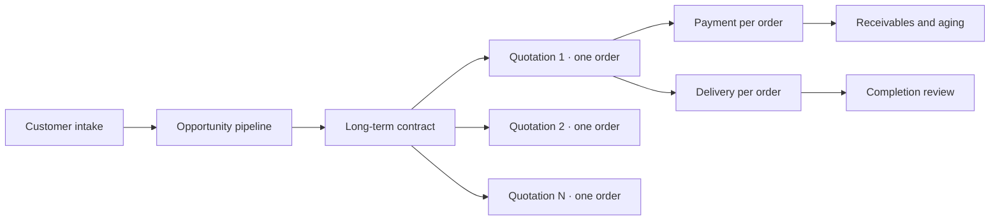
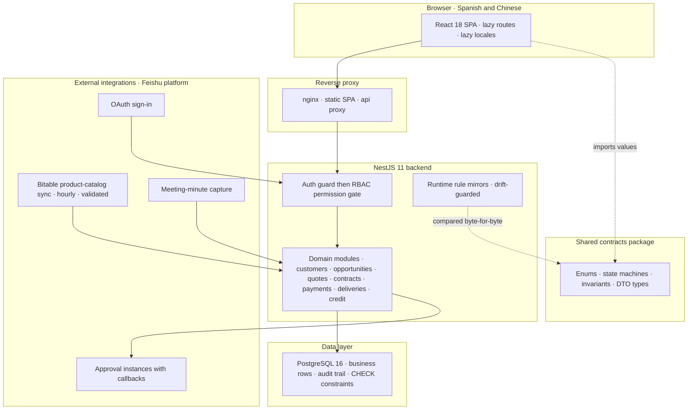

# SCMS · B2B Supply-Chain Operations Platform

**From first touch to cash collected — one audited commercial chain, in two languages.**

A bilingual, Spanish-first operations platform for a Latin-American B2B business: customer → opportunity → long-term contract → quotations opened under the contract → per-order payment → per-order delivery, all behind role-based access control. Built as a React + NestJS + Prisma monorepo on PostgreSQL.

[Overview](#-overview) · [Business Mainline](#-business-mainline) · [Architecture](#-architecture) · [Design Highlights](#-design-highlights) · [Guard Rails](#-guard-rails) · [Tech Stack](#-tech-stack)

**English** · [简体中文](README.zh.md)

> [!NOTE]
> This is a **documentation-only showcase**: no source code is published here. The implementation lives in a private repository and runs in production. Contact the author to arrange a guided code walkthrough.

## 📌 Overview

Most internal line-of-business tools rot in the same two places: the rules drift between frontend and backend, and the documentation stops matching the buttons. SCMS is built around stopping both.

The platform runs the whole commercial chain for a cross-border B2B operation — customer registry, opportunity pipeline, long-term contracts, quotations, payment reconciliation and delivery — in one database, with every state transition audited and every screen available in Spanish and Chinese. Spanish is the default, because the operators are in Latin America; Chinese serves the home office. Customer-facing documents — quotations, contracts, NDAs — are generated bilingually from one versioned legal-text source, **with Spanish as the signing text**.

## 🔗 Business Mainline

- A **contract is a long-term frame**. Orders are created as quotations *under* the contract — one quotation is one order, and a contract typically accumulates many.
- **Payment and delivery status attach to the order, never to the contract.** Contract-level figures are computed rollups of their orders; nothing at the contract level is hand-set.
- The chain is **enforced, not suggested**: a quotation must belong to a contract that traces back to a qualified opportunity, a shipment cannot exceed its order's allocation, and every transition writes an audit row with actor, before/after and reason.

Around the mainline sit the supporting domains: a qualification scorecard on intake, floor-price guards and validity windows on quotations, credit tiering with exposure tracking, payment reconciliation from bank slips with partial/prepay/balance legs, delivery tasks with allocation ceilings, and an executive cockpit of KPIs with year-over-year comparison.

## 🏗 Architecture

External systems can never write straight into PostgreSQL: the product sync writes through a mapping layer that validates every record and escalates failures to an exception centre rather than storing something that would violate an invariant. Columns the system owns are excluded from the sync, so an upstream edit can't overwrite an approval decision.

## 💡 Design Highlights

**The rules live once.** Every enum, state machine, invariant and DTO is declared in a shared contracts package. The API is forbidden from importing *values* from it — types only — and keeps its own runtime mirror in rule files that drift tests compare byte-for-byte against the source. The duplication is deliberate: the API builds and deploys independently of the frontend's bundler, and a mismatch fails the build, not production.

**Derived state is computed, never stored as truth.** Contract payment status, delivery status, credit exposure and conversion rates are all functions of their underlying rows. The one materialized exception — remaining allocation — exists for a measured query-cost reason and is documented at the field.

**Two languages, equally first-class.** Locales load lazily per language, key-parity tests fail the build when a string misses a translation, and PDF generation produces bilingual documents from a single versioned legal-text source.

**Approvals degrade cleanly.** Contract, pricing and finance gates can run as Feishu approval instances with callback replay — or, when not configured, fall back to in-system approval buttons. An unset integration reports exactly what is missing; it never pretends to have synced.

## 🛡 Guard Rails

- **Drift tests** hold frontend and backend rule definitions identical; a one-sided change goes red in CI.
- **RBAC, down to the field**: roles × permissions gate routes, navigation, actions and fields. A role without price access receives a DTO with the field *absent*, not hidden.
- **One audit trail**: every state transition records actor, before/after values and reason.
- **Validated input everywhere**: request bodies pass through a mandatory validation wrapper, and a guard test fails any endpoint that takes a bare body.
- **Anonymous surfaces are write-only and staged**: a public intake page and mobile document upload land in a staging area, rate-limited in separate buckets, and only become records after an authenticated confirmation.
- **Every list is paginated** — server-side where data grows — with selectable page sizes, an "x–y of N" counter and a reset to page 1 on any filter change.
- **2,900+ tests** cover invariants, state machines, accessibility assertions and the drift guards above.

## 🧱 Tech Stack

| Layer | Choice |
|---|---|
| Monorepo | pnpm workspaces — web app, API and a shared contracts package |
| Frontend | React 18.3 + Vite, TanStack Query, Radix primitives + design tokens, i18next with per-language lazy resources |
| Backend | NestJS 11, module per domain, Prisma 6 on PostgreSQL 16 |
| Database | Schema-first; `CHECK` constraints mirror the app-level invariants |
| Auth | OAuth sign-in via the Feishu platform + JWT sessions, progressive enforcement switch |
| Documents | Bilingual PDF generation for quotations, contracts and NDAs |
| Testing | Vitest + Testing Library; drift guards, invariant guards, a11y assertions |
| Deployment | Four-container Docker Compose stack behind nginx |

## 📄 License

All rights reserved. Documentation only; no license is granted for the described implementation.
