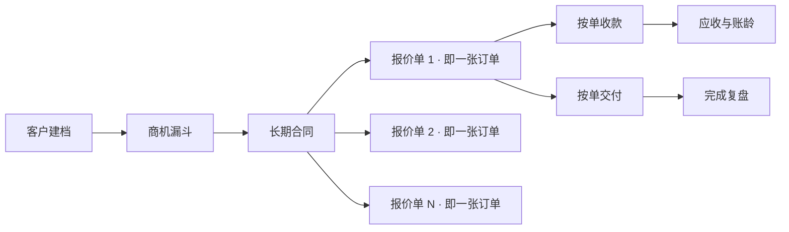
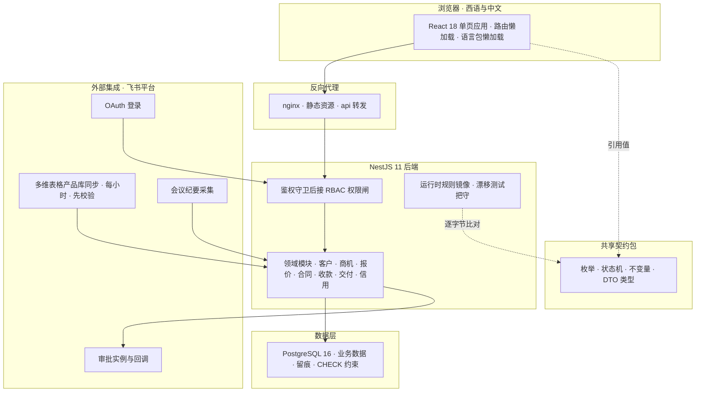

# SCMS · B2B 供应链经营平台

**从第一次接触到回款落袋 —— 一条全程留痕的经营链路，两种语言。**

面向拉美市场的中西双语 B2B 经营平台：客户 → 商机 → 长期合同 → 合同下开报价单 → 按单收款 → 按单交付，全程在 RBAC 之后。React + NestJS + Prisma monorepo，数据库 PostgreSQL。

[概述](#-概述) · [业务主链路](#-业务主链路) · [架构](#-架构) · [设计要点](#-设计要点) · [工程铁律](#-工程铁律) · [技术栈](#-技术栈)

[English](README.md) · **简体中文**

> [!NOTE]
> 这是一份**纯文档 showcase**：本仓库不包含任何源码。实现在私有仓库中，并已在生产环境运行。如需了解实现细节，可联系作者安排代码走读。

## 📌 概述

内部业务系统最常见的两种溃烂方式：规则在前后端之间悄悄漂移，文档和按钮渐渐对不上号。SCMS 的整个设计就是围绕堵住这两个口子。

平台把跨境 B2B 业务的整条经营链路 —— 客户档案、商机漏斗、长期合同、报价单、收款对账、交付 —— 放进一个数据库，每次状态变更都留痕，每个页面都有西语和中文两个版本。西语是默认语言，因为一线操作者在拉美；中文服务于国内团队。对客单据 —— 报价单、合同、保密协议 —— 由同一份带版本号的法务文案双语生成，**以西语为签署文本**。

## 🔗 业务主链路

- **合同是长期框架。** 订单以报价单的形式开在合同*之下* —— 一张报价单就是一张订单，一份合同通常会累积多张。
- **付款和交付状态挂在订单上，从不挂在合同上。** 合同层面的数字全部由其订单计算汇总而来，没有任何合同级状态是手工设置的。
- 链路是**强制的，不是口头约定**：报价单必须属于一份能追溯到合格商机的合同，发货不能超过订单的配额，每次状态变更都写一行留痕 —— 操作人、前后值、原因。

主链路之外是配套领域：建档时的资质评分卡、报价单的底价守卫和有效期窗口、客户信用分级与敞口跟踪、按水单对账的收款（支持定金/尾款/部分收款）、带配额上限的交付任务，以及带同比对比的经营驾驶舱。

## 🏗 架构

外部系统永远不能直接写 PostgreSQL：产品同步要经过一层映射校验，不合法的记录会升级到异常中心，而不是把一条会破坏不变量的数据存进去。系统自己拥有的列被排除在同步之外，所以上游的一次编辑覆盖不掉一个审批结论。

## 💡 设计要点

**规则只写一次。** 所有枚举、状态机、不变量和 DTO 都声明在共享契约包里。API 被禁止从中引用*值* —— 只能引用类型 —— 并在本地规则文件里维护一份运行时镜像，由漂移测试与源头逐字节比对。这份重复是刻意的：API 可以脱离前端打包器独立构建和部署，而一旦两边不一致，红的是构建，不是生产环境。

**派生状态只计算、不落库。** 合同的付款状态、交付状态、信用敞口、转化率，全部是底层数据行的函数。唯一一个物化的例外 —— 剩余配额 —— 有实测的查询成本依据，并在字段处写明了原因。

**两种语言同等一等公民。** 语言包按语言懒加载，词条一致性测试会在缺译时让构建失败，PDF 由同一份带版本的法务文案生成双语单据。

**审批优雅降级。** 合同、价格、财务等审批闸可以走飞书审批实例并支持回调重放；未配置时降级为系统内审批按钮。没配好的集成会明确报告缺什么，绝不伪装成「已同步」。

## 🛡 工程铁律

- **漂移测试**保证前后端规则定义完全一致；单边改动在 CI 里直接红灯。
- **RBAC 细到字段**：角色 × 权限控制路由、导航、动作和字段。没有价格权限的角色拿到的 DTO 里该字段是*不存在*，不是隐藏。
- **一条留痕**：每次状态变更都记录操作人、前后值和原因。
- **输入全量校验**：请求体必须经过统一的校验包装器，守卫测试会拦下任何裸接收请求体的端点。
- **匿名入口只写不读、先暂存**：公开建档页和手机传单据先落到暂存区，限流各用各的桶，经登录确认后才成为正式记录。
- **列表一律分页** —— 数据会变大的走服务端分页 —— 每页条数可选，显示「第 x–y 条，共 N 条」，筛选变化回到第 1 页。
- **2900+ 条测试**覆盖不变量、状态机、无障碍断言和上述全部守卫。

## 🧱 技术栈

| 层 | 选型 |
|---|---|
| Monorepo | pnpm workspaces —— web 应用、API 与共享契约包 |
| 前端 | React 18.3 + Vite、TanStack Query、Radix 原语 + 设计令牌、i18next 按语言懒加载 |
| 后端 | NestJS 11，一域一模块，Prisma 6 + PostgreSQL 16 |
| 数据库 | Schema 先行；`CHECK` 约束与应用层不变量互为镜像 |
| 鉴权 | 飞书平台 OAuth 登录 + JWT 会话，渐进式强制开关 |
| 单据 | 报价单、合同、保密协议双语 PDF 生成 |
| 测试 | Vitest + Testing Library；漂移守卫、不变量守卫、无障碍断言 |
| 部署 | nginx 之后的四容器 Docker Compose 栈 |

## 📄 许可

保留所有权利。本仓库仅为文档；不对所述实现授予任何许可。
